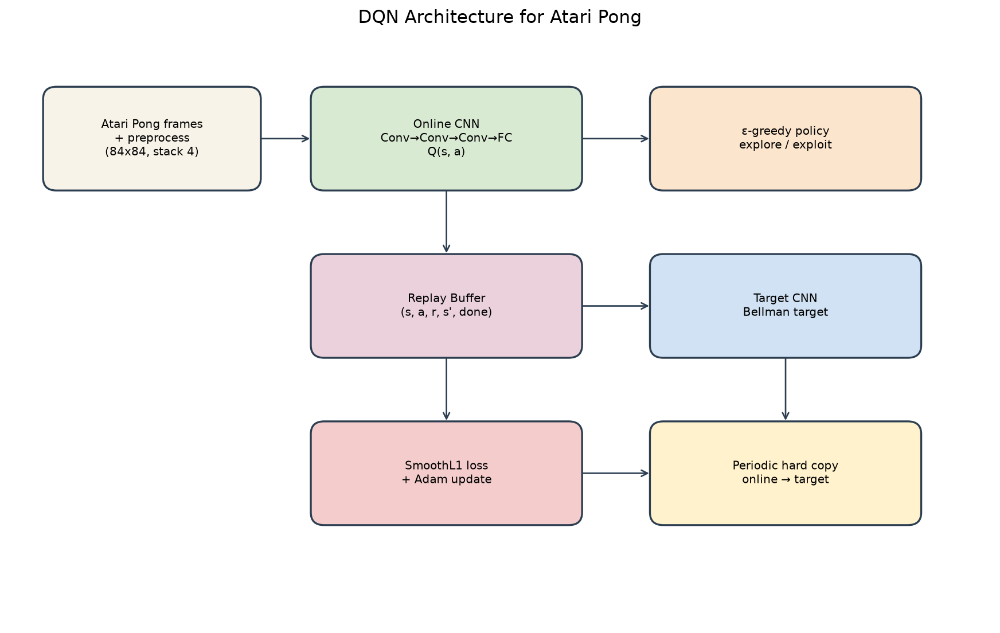

# Deep Q-Learning (Atari Pong)

Group project: implement DQN from scratch with PyTorch + Gymnasium and train it on Pong.

We are **not** using Stable-Baselines3, RLlib, CleanRL, or TorchRL.

## Group members

| Name | Folder / results file |
|---|---|
| Berissa Muyizere | `experiments/berissa/`, `Berissa_Hyperparameter_experiment_results.md` |
| Hugues Munezero | `experiments/hugues/`, `Hugues_Hyperparameter_experiment_results.md` |
| Jacques Twizeyimana | `experiments/jacques/`, `Jacques_Hyperparameter_experiment_results.md` |

## Environment

- Game: **Pong** (`ALE/Pong-v5`)
- Goal: move the right paddle and score points
- Reward: usually +1 when we score, -1 when the opponent scores

We picked Pong because it trains faster than most other Atari games and the reward is easy to understand.

## Setup (uv)

```bash
uv sync
```

## How to train

```bash
uv run python train.py --member berissa --experiment 1

# change hyperparameters for other experiments
uv run python train.py --member berissa --experiment 2 \
  --learning-rate 5e-5 --gamma 0.99 --batch-size 32 \
  --epsilon-start 1.0 --epsilon-end 0.01 --epsilon-decay 1e-6
```

Each run saves:

- model: `experiments/<member>/expXX/dqn_model.pth`
- best model: `experiments/<member>/expXX/dqn_model_best.pth`
- plot: `plots/<member>/expXX_training.png`
- logs: `experiments/<member>/expXX/training_log.csv`

After you find the best run, copy it for the demo:

```bash
cp experiments/<member>/expXX/dqn_model_best.pth dqn_model.pth
```

## How to play

```bash
uv run python play.py
uv run python play.py --model experiments/berissa/exp01/dqn_model_best.pth
```

## DQN pieces we implemented

1. **CNN Q-network** (`dqn/network.py`)  
   Input: 4 stacked 84x84 grayscale frames  
   Conv layers → FC 512 → Q-value for each action

2. **Replay buffer** (`dqn/replay_buffer.py`)  
   Stores transitions and samples random batches

3. **Online + target networks** (`dqn/agent.py`)  
   Online net is trained. Target net is used for the Bellman target and updated every N steps.

4. **ε-greedy**  
   With probability ε take a random action, otherwise take `argmax Q(s, a)`. ε decays during training.

5. **Loss**  
   Smooth L1 between `Q(s,a)` and `r + γ max Q_target(s', a')`

Architecture diagram:



## Training plots

Training plots go in `plots/`. Document episode reward, episode length, and steps in your experiment results file.

## Gameplay demo

Record a short video of:

```bash
uv run python play.py --model dqn_model.pth
```

Put it in `demos/` and link it here before submission.

## Files required for submission

- `train.py`, `play.py`
- models under each member folder
- training plots
- 3 hyperparameter results markdown files
- `README.md`
- `Task_allocation_sheet.pdf`
- presentation booking PDF
